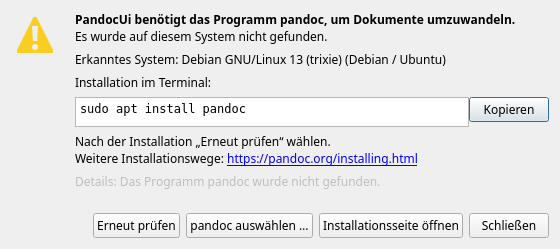
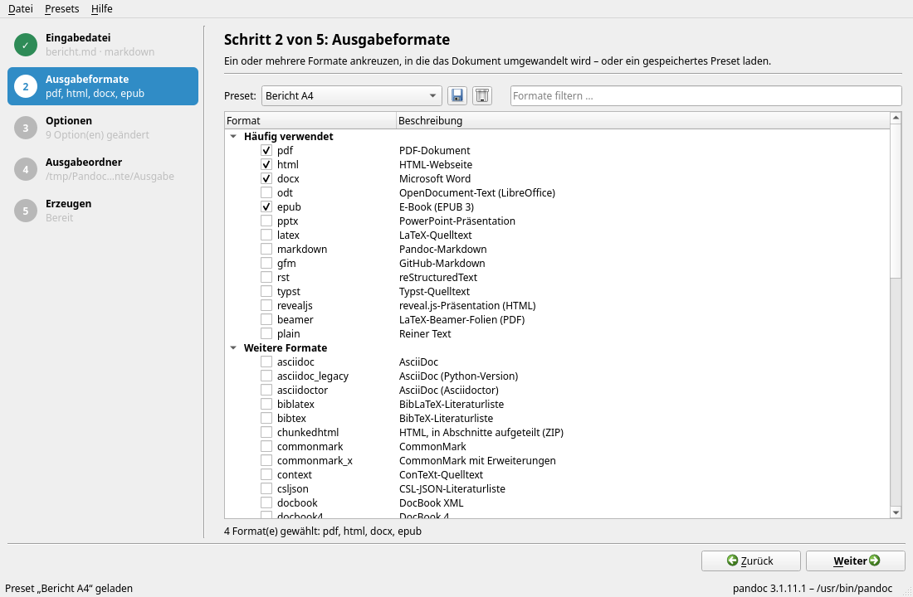
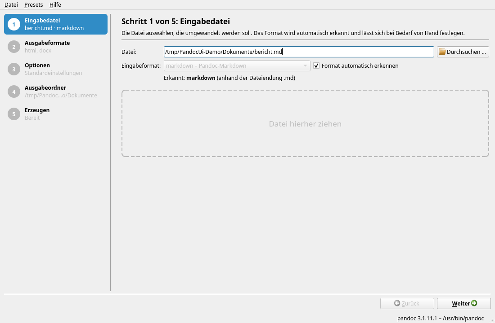
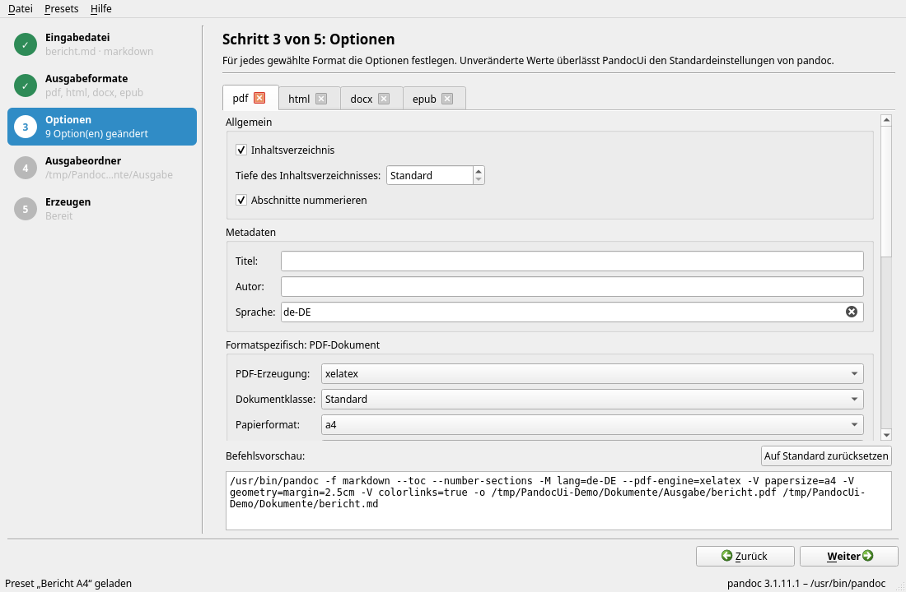
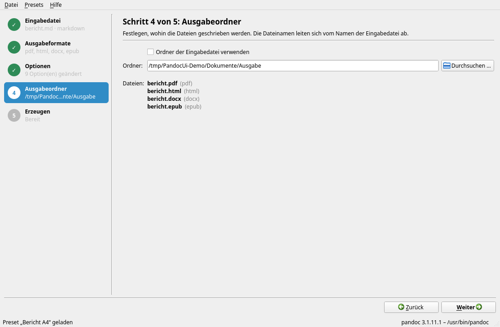
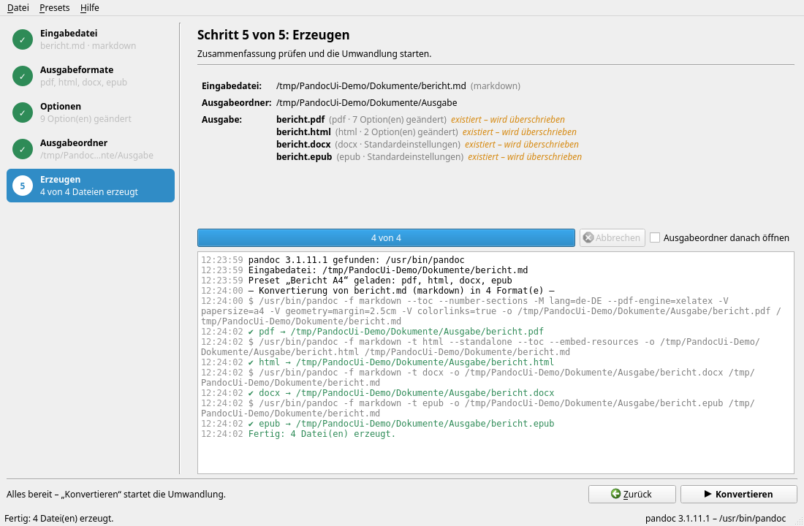

# PandocUi – Benutzerhandbuch

PandocUi ist eine grafische Oberfläche für [pandoc](https://pandoc.org). Damit wandeln Sie
ein Dokument – etwa eine Markdown-, Word- oder HTML-Datei – in einem Durchgang in ein oder
mehrere andere Formate um: PDF, Word, HTML, E-Book, Präsentation und viele mehr. Die
Befehlszeile von pandoc müssen Sie dafür nicht kennen.

Dieses Handbuch ist auch in PandocUi selbst enthalten: *Hilfe → PandocUi-Handbuch* oder F1.

## Inhalt

1. [Installation](#1-installation)
2. [Erster Start und pandoc](#2-erster-start-und-pandoc)
3. [Das Hauptfenster](#3-das-hauptfenster)
4. [Schritt 1: Eingabedatei](#4-schritt-1-eingabedatei)
5. [Schritt 2: Ausgabeformate](#5-schritt-2-ausgabeformate)
6. [Schritt 3: Optionen](#6-schritt-3-optionen)
7. [Schritt 4: Ausgabeordner](#7-schritt-4-ausgabeordner)
8. [Schritt 5: Erzeugen](#8-schritt-5-erzeugen)
9. [Presets](#9-presets)
10. [Sprache der Oberfläche](#10-sprache-der-oberfläche)
11. [Menüs und Tastenkürzel](#11-menüs-und-tastenkürzel)
12. [Start über die Befehlszeile](#12-start-über-die-befehlszeile)
13. [Häufige Fragen und Probleme](#13-häufige-fragen-und-probleme)

---

## 1. Installation

Fertige Pakete stehen auf der Release-Seite des Projekts bereit:

| System | Datei | Installation |
|--------|-------|--------------|
| Windows (64 Bit) | `PandocUi-<version>-windows-x64.exe` | Keine Installation nötig – die Datei an einen beliebigen Ort kopieren und starten. |
| macOS ab 13 | `PandocUi-<version>-macos-universal.dmg` | Image öffnen und *PandocUi* in den Ordner *Programme* ziehen. |
| Debian/Ubuntu | `pandocui_<version>_debian13_amd64.deb` | `sudo apt install ./pandocui_<version>_debian13_amd64.deb` |
| Rocky Linux/RHEL/Fedora | `pandocui-<version>-1.el10.x86_64.rpm` | `sudo dnf install ./pandocui-<version>-1.el10.x86_64.rpm` |

Unter Linux erscheint PandocUi danach im Anwendungsmenü.

**macOS:** Die App ist nicht von Apple notarisiert. Beim ersten Start meldet macOS, dass der
Entwickler nicht überprüft werden kann. Starten Sie die App dann einmal per Rechtsklick →
*Öffnen*, oder entfernen Sie die Quarantäne-Markierung im Terminal:

```bash
xattr -dr com.apple.quarantine /Applications/PandocUi.app
```

### Zusätzlich benötigte Programme

- **pandoc** muss installiert sein – PandocUi bringt es nicht mit (siehe [Abschnitt 2](#2-erster-start-und-pandoc)).
- **Für PDF** braucht pandoc zusätzlich eine PDF-Engine, z. B. `pdflatex`/`xelatex`/`lualatex`
  (aus TeX Live oder MiKTeX), `typst`, `weasyprint` oder `wkhtmltopdf`. Welche verwendet wird,
  legen Sie in den PDF-Optionen fest.

## 2. Erster Start und pandoc

Beim Start sucht PandocUi das Programm pandoc – zuerst an einem selbst festgelegten Ort,
dann im Suchpfad (`PATH`) und schließlich an den üblichen Installationsorten
(unter Windows z. B. `%LOCALAPPDATA%\Pandoc`, unter macOS `/opt/homebrew/bin`).
Die gefundene Version steht rechts unten in der Statuszeile.

Wird pandoc nicht gefunden, öffnet sich der Dialog **„pandoc nicht gefunden“**:



Er erkennt Ihr Betriebssystem und zeigt den passenden Installationsbefehl, z. B.

| System | Befehl |
|--------|--------|
| Windows | `winget install --id JohnMacFarlane.Pandoc` |
| macOS (Homebrew) | `brew install pandoc` |
| Debian/Ubuntu | `sudo apt install pandoc` |
| Fedora | `sudo dnf install pandoc` |
| Rocky Linux/RHEL | `sudo dnf install epel-release` und danach `sudo dnf install pandoc` |

- **Kopieren** legt die Befehle in die Zwischenablage, damit Sie sie im Terminal einfügen können.
- **Erneut prüfen** sucht nach der Installation noch einmal nach pandoc – ein Neustart von
  PandocUi ist nicht nötig.
- **pandoc auswählen …** lässt Sie das Programm selbst angeben, falls es an einem
  ungewöhnlichen Ort liegt.
- **Installationsseite öffnen** führt zur Installationsanleitung auf pandoc.org.

Sie können den Dialog auch schließen und sich die Oberfläche ansehen; umwandeln lässt sich
erst, wenn pandoc verfügbar ist. Später können Sie das Programm jederzeit über
*Datei → pandoc-Programm festlegen …* ändern.

## 3. Das Hauptfenster

PandocUi führt Sie als Assistent durch fünf Schritte:



- **Schrittleiste (links):** Zeigt alle Schritte mit einer Kurzfassung Ihrer Auswahl.
  Erledigte Schritte tragen einen Haken. Ein Klick springt direkt zu einem Schritt – sofern
  die vorherigen Schritte vollständig sind.
- **Arbeitsbereich (rechts):** Enthält nur die Seite des aktuellen Schritts mit einer kurzen
  Erklärung oben.
- **Fußzeile:** Links steht ein Hinweis, was noch fehlt (z. B. „Bitte einen Ausgabeordner
  wählen.“). Rechts führen **Zurück** (Alt+Z) und **Weiter** (Alt+W) durch den Ablauf; im
  letzten Schritt wird daraus **Konvertieren**.
- **Statuszeile (unten):** Meldungen und die verwendete pandoc-Version.

Alle Einstellungen – gewählte Formate, Optionen, Ordner, Fenstergröße – werden beim Beenden
gespeichert und beim nächsten Start wiederhergestellt.

## 4. Schritt 1: Eingabedatei



Wählen Sie die Datei, die umgewandelt werden soll. Dafür gibt es drei Wege:

- **Durchsuchen …** bzw. *Datei → Eingabedatei öffnen …* (Strg+O),
- den Pfad in das Eingabefeld tippen oder einfügen,
- die Datei aus dem Explorer/Finder **in das Fenster ziehen** – das funktioniert in jedem Schritt.

Das **Eingabeformat** erkennt PandocUi automatisch, meist an der Dateiendung (`.md` →
Markdown, `.docx` → Word …). Bei `.xml`- und `.json`-Dateien wird der Inhalt untersucht,
weil diese Endungen zu mehreren Formaten gehören können. Unter dem Feld steht, was erkannt
wurde und woran.

Ist die Erkennung falsch oder nicht möglich, entfernen Sie den Haken bei
**„Format automatisch erkennen“** und wählen das Format aus der Liste.

## 5. Schritt 2: Ausgabeformate


Kreuzen Sie ein oder mehrere Formate an, die erzeugt werden sollen.

- Unter **„Häufig verwendet“** stehen gängige Formate wie PDF, Word (DOCX), HTML, ODT,
  EPUB oder PowerPoint.
- Unter **„Weitere Formate“** folgen alle übrigen Formate, die Ihre pandoc-Version anbietet.
- Das Feld **„Formate filtern …“** grenzt die Liste ein, z. B. auf alles mit „html“.
- Über **Preset** oben laden Sie eine gespeicherte Zusammenstellung aus Formaten und
  Optionen (siehe [Presets](#9-presets)).

Die Formate werden in der Reihenfolge erzeugt, in der Sie sie angekreuzt haben.

## 6. Schritt 3: Optionen



Für jedes gewählte Format gibt es einen eigenen Reiter. Die Optionen gelten nur für dieses
Format – Sie können also z. B. für PDF ein Inhaltsverzeichnis einschalten und für Word nicht.

Felder, die Sie nicht ändern, stehen auf **„Standard“**; dann entscheidet pandoc selbst.
Jedes Feld hat einen Tooltip, der erklärt, welche pandoc-Option dahintersteht.

### Allgemein

| Option | Bedeutung |
|--------|-----------|
| Vollständiges Dokument | Ausgabe mit Kopf- und Fußteil statt als Fragment (bei HTML, LaTeX u. ä.) |
| Inhaltsverzeichnis | Automatisches Inhaltsverzeichnis einfügen |
| Tiefe des Inhaltsverzeichnisses | Wie viele Überschriftenebenen es aufnimmt |
| Abschnitte nummerieren | Überschriften durchnummerieren (1, 1.1, …) |

### Metadaten

**Titel**, **Autor** und **Sprache** (als Code wie `de-DE` oder `en-US`) des Dokuments.
Die Werte überschreiben Angaben aus der Eingabedatei. Die Sprache beeinflusst u. a.
Silbentrennung und Beschriftungen wie „Inhaltsverzeichnis“.

### Formatspezifisch

Je nach Format erscheinen passende Optionen, zum Beispiel:

| Format | Optionen (Auswahl) |
|--------|--------------------|
| PDF, LaTeX | PDF-Erzeugung (Engine), Dokumentklasse, Papierformat, Schriftgröße, Seitenränder, Schriftart, Zeilenabstand, farbige Links, Abbildungs- und Tabellenverzeichnis |
| Word (DOCX), ODT | Vorlage (Referenzdokument), deren Formatvorlagen übernommen werden |
| PowerPoint (PPTX) | Vorlage, deren Folienlayouts übernommen werden |
| HTML | Ressourcen einbetten (alles in einer Datei), Stylesheet (CSS), Formeldarstellung |
| reveal.js, Beamer | Folienebene, Listen schrittweise einblenden, Design, Folienübergang bzw. Seitenverhältnis |
| EPUB | Titelbild, Stylesheet, Metadaten (XML), eingebettete Schrift, Kapitelebene |
| Markdown-Varianten | Referenz-Links, Überschriftenstil |
| Typst | Papierformat, Schriftart, Schriftgröße |
| Jupyter Notebook | Welche Zellausgaben übernommen werden |

**Tipp für Word:** Speichern Sie ein Word-Dokument mit Ihren Formatvorlagen (Schriften,
Überschriften, Kopfzeile) und tragen Sie es als *Vorlage (Referenzdokument)* ein. Das
erzeugte Dokument übernimmt dann dieses Aussehen.

### Erweitert

| Option | Bedeutung |
|--------|-----------|
| Vorlage (Template) | Eigene pandoc-Vorlage |
| Syntaxhervorhebung | Farbschema für Quelltextblöcke |
| Zeilenumbruch, Zeilenbreite | Umbruch langer Zeilen in Textformaten |
| Literaturangaben verarbeiten | Zitate auflösen und Literaturverzeichnis erzeugen |
| Literaturdatenbank, Zitierstil (CSL) | Literaturdatei (`.bib`, `.json`, `.yaml`, `.ris`) und Zitierstil |
| Lua-Filter | Skript, das das Dokument während der Umwandlung verändert |

### Weitere pandoc-Argumente

Alles, wofür es kein eigenes Feld gibt, tragen Sie hier ein, z. B.
`--shift-heading-level-by=1 --dpi=150`. Die Argumente werden unverändert an pandoc
übergeben. Eine Übersicht aller Argumente bietet *Hilfe → pandoc-Handbuch (online)*.

### Befehlsvorschau und Zurücksetzen

Unten im Reiter zeigt die **Befehlsvorschau** laufend den pandoc-Befehl, der für dieses
Format ausgeführt wird. **Auf Standard zurücksetzen** setzt alle Optionen des Reiters zurück.

## 7. Schritt 4: Ausgabeordner



Wählen Sie, wohin die Dateien geschrieben werden:

- **„Ordner der Eingabedatei verwenden“** legt die Ergebnisse neben die Eingabedatei, oder
- über **Durchsuchen …** bzw. das Eingabefeld einen beliebigen Ordner wählen. Existiert er
  noch nicht, wird er beim Umwandeln angelegt.

Unter **Dateien** sehen Sie vorab alle Namen der Ausgabedateien. Sie ergeben sich aus dem
Namen der Eingabedatei, z. B. `bericht.md` → `bericht.pdf`, `bericht.docx`. Haben mehrere
Formate dieselbe Endung, wird der Formatname eingefügt (`bericht.html`,
`bericht.revealjs.html`).

Dateien, die bereits existieren, sind mit **„existiert – wird überschrieben“** markiert.
Die Eingabedatei selbst wird nie überschrieben.

## 8. Schritt 5: Erzeugen



Die **Zusammenfassung** zeigt noch einmal Eingabedatei, Ausgabeordner und alle
Ausgabedateien samt der Anzahl geänderter Optionen je Format.

1. Optional **„Ausgabeordner danach öffnen“** ankreuzen.
2. **Konvertieren** klicken (oder Strg+Eingabe – das geht auch aus jedem anderen Schritt,
   sobald alles vollständig ist).
3. Existieren bereits Ausgabedateien, fragt PandocUi vor dem Überschreiben nach.

Die Formate werden nacheinander erzeugt. Der Fortschrittsbalken zeigt „x von y“, das
**Protokoll** listet die ausgeführten Befehle, Meldungen von pandoc sowie Erfolge (✔) und
Fehler (✘) farblich hervorgehoben. Mit **Abbrechen** stoppen Sie die laufende Umwandlung;
bereits erzeugte Dateien bleiben erhalten.

Schlägt ein Format fehl, werden die übrigen trotzdem erzeugt. Am Ende steht eine
Zusammenfassung wie „Fertig mit Fehlern: 2 erfolgreich, 1 fehlgeschlagen.“ – die genaue
Ursache finden Sie im Protokoll direkt über dieser Zeile.

## 9. Presets

Ein **Preset** speichert die gewählten Ausgabeformate (in ihrer Reihenfolge) mitsamt allen
Optionen unter einem Namen – etwa „Bericht A4“ für PDF + Word mit Firmenvorlage. Eingabedatei
und Ausgabeordner gehören nicht dazu, sodass ein Preset für beliebige Dokumente passt.

| Aktion | So geht's |
|--------|-----------|
| Speichern | Diskettensymbol neben der Preset-Auswahl in Schritt 2, oder *Presets → Als Preset speichern …* (Strg+S). Gibt es den Namen schon, wird vor dem Überschreiben gefragt. |
| Laden | Preset in der Auswahlliste in Schritt 2 wählen. Formate und Optionen werden ersetzt. |
| Löschen | Papierkorbsymbol oder *Presets → Preset löschen* |
| Weitergeben | *Presets → Preset exportieren …* speichert eine JSON-Datei, die andere über *Presets → Preset importieren …* übernehmen. |
| Ordner öffnen | *Presets → Preset-Ordner öffnen* zeigt den Ordner, in dem die Presets liegen. |

Speicherorte der Presets:

- Windows: `%APPDATA%\PandocUi\PandocUi\presets`
- Linux: `~/.local/share/PandocUi/PandocUi/presets`
- macOS: `~/Library/Application Support/PandocUi/PandocUi/presets`

Enthält ein Preset ein Format, das Ihre pandoc-Version nicht kennt, wird es beim Laden
übersprungen und im Protokoll gemeldet.

## 10. Sprache der Oberfläche

PandocUi gibt es auf **Deutsch** und **Englisch**. Standardmäßig richtet sich die Sprache nach
dem System; ist das System nicht auf Deutsch eingestellt, erscheint Englisch.

Umstellen lässt sie sich über *Datei → Sprache*. Die neue Sprache gilt ab dem nächsten Start;
PandocUi bietet an, sofort neu zu starten. *Systemsprache* stellt wieder auf die
automatische Auswahl zurück.

## 11. Menüs und Tastenkürzel

| Menü | Eintrag | Kürzel |
|------|---------|--------|
| Datei | Eingabedatei öffnen … | Strg+O |
| Datei | Konvertieren | Strg+Eingabe |
| Datei | pandoc-Programm festlegen … | |
| Datei | Sprache | |
| Datei | Beenden | Strg+Q (Linux, macOS), Alt+F4 (Windows) |
| Presets | Als Preset speichern … | Strg+S |
| Presets | Preset löschen, importieren …, exportieren …, Ordner öffnen | |
| Hilfe | PandocUi-Handbuch (dieses Handbuch) | F1 |
| Hilfe | pandoc-Handbuch (online), Über PandocUi, Über Qt | |
| – | Zurück / Weiter | Alt+Z / Alt+W |

Unter macOS steht ⌘ an Stelle von Strg. In der englischen Oberfläche lauten die Kürzel für
Zurück/Weiter Alt+B / Alt+N.

Im Handbuch-Fenster springt **Inhalt** zurück zum Inhaltsverzeichnis. Das Suchfeld oben
rechts (Strg+F) findet Begriffe im Handbuch: Eingabe springt zum nächsten Treffer,
Umschalt+Eingabe zum vorherigen.

Während einer Umwandlung sind die Einträge gesperrt, die sie stören würden. Wird PandocUi
während einer laufenden Umwandlung geschlossen, fragt es vorher nach.

## 12. Start über die Befehlszeile

```bash
PandocUi [--lang <sprache>] [datei]
```

- `datei` – Eingabedatei, die gleich geöffnet wird. So lässt sich PandocUi z. B. als
  „Öffnen mit …“-Programm für Markdown-Dateien eintragen.
- `--lang de` bzw. `--lang en` – Sprache der Oberfläche nur für diesen Start.
- `--help`, `--version` – Hilfe bzw. Versionsnummer.

## 13. Häufige Fragen und Probleme

**„pandoc nicht gefunden“, obwohl pandoc installiert ist.**
Wurde pandoc gerade erst installiert, kennt das laufende Programm den neuen Suchpfad unter
Umständen noch nicht. Klicken Sie im Dialog auf *pandoc auswählen …* und geben Sie die
Datei direkt an (unter Windows meist `%LOCALAPPDATA%\Pandoc\pandoc.exe`), oder starten Sie
PandocUi neu.

**Die PDF-Erzeugung schlägt fehl.**
Meist fehlt die PDF-Engine. Im Protokoll steht dann etwa, dass `pdflatex` nicht gefunden
wurde. Installieren Sie eine LaTeX-Distribution (TeX Live, MiKTeX) oder wählen Sie in den
PDF-Optionen unter *PDF-Erzeugung* ein Programm, das vorhanden ist, z. B. `typst`.

**Umlaute oder Sonderzeichen fehlen im PDF / eine bestimmte Schrift soll verwendet werden.**
Stellen Sie *PDF-Erzeugung* auf `xelatex` oder `lualatex` und tragen Sie unter *Schriftart*
eine installierte Schrift ein. Mit `pdflatex` wird die Option *Schriftart* nicht beachtet.

**Bilder fehlen in der HTML-Datei, wenn ich sie weitergebe.**
Schalten Sie in den HTML-Optionen *Ressourcen einbetten* ein. Dann stecken Bilder und
Stylesheets in der einen HTML-Datei.

**Ein Format fehlt in der Liste.**
Die Liste stammt von der installierten pandoc-Version. Neuere Formate (z. B. Typst) gibt es
erst in neueren pandoc-Versionen – aktualisieren Sie pandoc.

**Wie sieht der genaue pandoc-Befehl aus?**
Die Befehlsvorschau in Schritt 3 zeigt ihn je Format; beim Umwandeln steht er zusätzlich
im Protokoll. Sie können ihn kopieren und selbst im Terminal ausführen.

**Wo finde ich alle pandoc-Optionen?**
*Hilfe → pandoc-Handbuch (online)* öffnet die offizielle Dokumentation.
