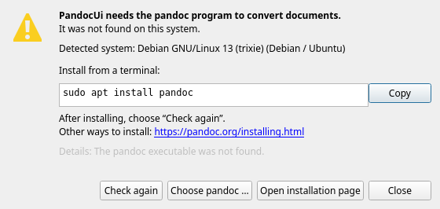
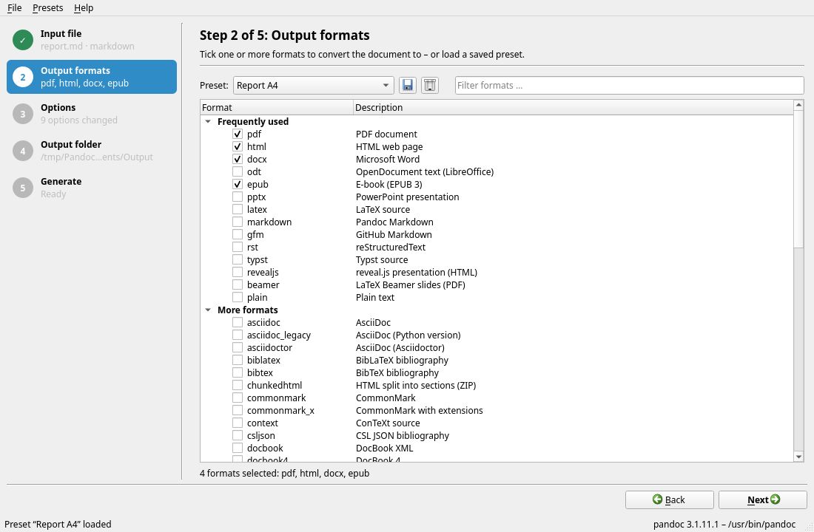
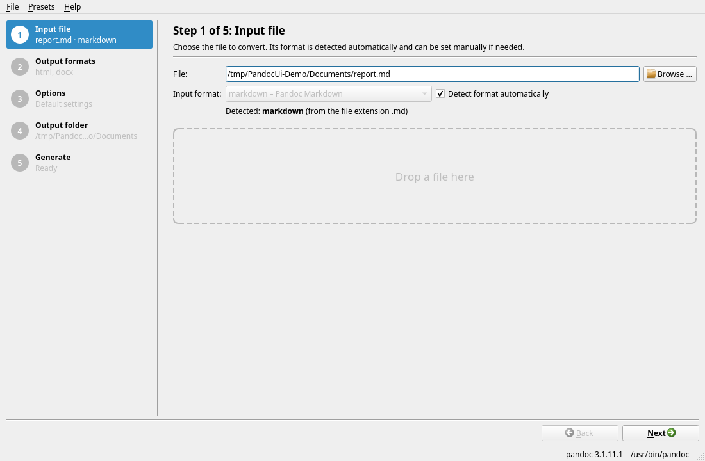
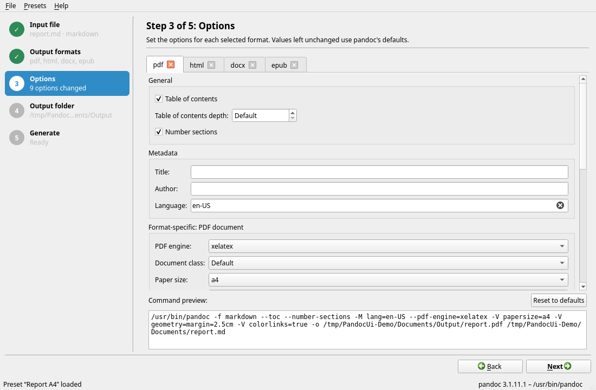
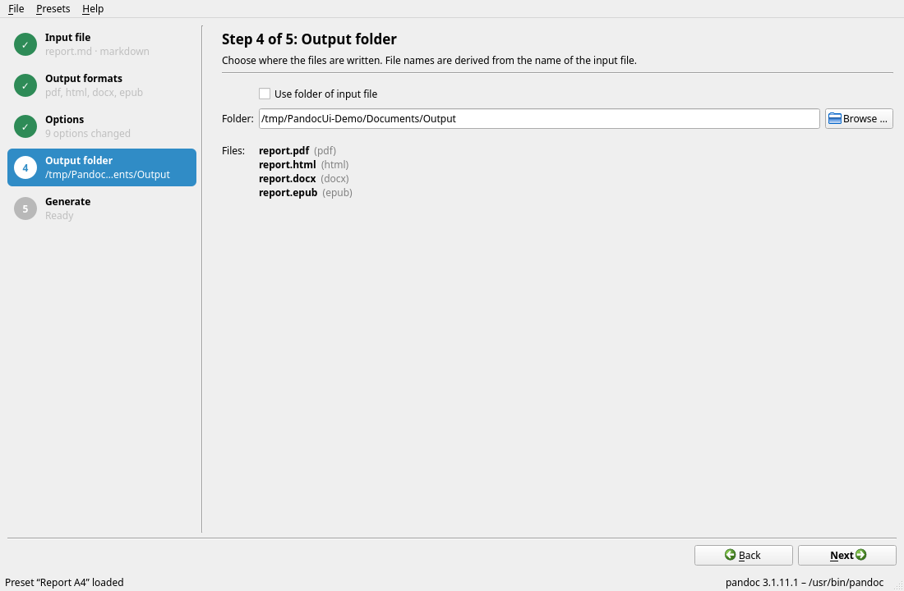
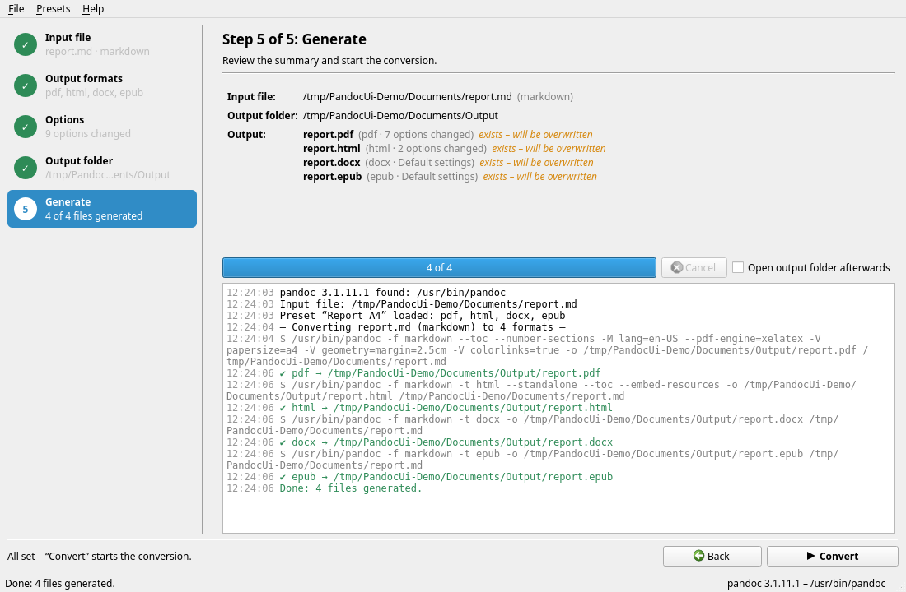

# PandocUi – User Manual

PandocUi is a graphical user interface for [pandoc](https://pandoc.org). It converts a
document – for example a Markdown, Word or HTML file – into one or more other formats in a
single run: PDF, Word, HTML, e-book, presentation and many more. You don't need to know
pandoc's command line.

This manual is also built into PandocUi: *Help → PandocUi manual* or F1.

## Contents

1. [Installation](#1-installation)
2. [First start and pandoc](#2-first-start-and-pandoc)
3. [The main window](#3-the-main-window)
4. [Step 1: Input file](#4-step-1-input-file)
5. [Step 2: Output formats](#5-step-2-output-formats)
6. [Step 3: Options](#6-step-3-options)
7. [Step 4: Output folder](#7-step-4-output-folder)
8. [Step 5: Generate](#8-step-5-generate)
9. [Presets](#9-presets)
10. [User interface language](#10-user-interface-language)
11. [Menus and keyboard shortcuts](#11-menus-and-keyboard-shortcuts)
12. [Starting from the command line](#12-starting-from-the-command-line)
13. [Frequently asked questions and problems](#13-frequently-asked-questions-and-problems)

---

## 1. Installation

Ready-made packages are available on the project's releases page:

| System | File | Installation |
|--------|------|--------------|
| Windows (64-bit) | `PandocUi-<version>-windows-x64.exe` | No installation needed – copy the file anywhere and run it. |
| macOS 13 or later | `PandocUi-<version>-macos-universal.dmg` | Open the image and drag *PandocUi* into the *Applications* folder. |
| Debian/Ubuntu | `pandocui_<version>_debian13_amd64.deb` | `sudo apt install ./pandocui_<version>_debian13_amd64.deb` |
| Rocky Linux/RHEL/Fedora | `pandocui-<version>-1.el10.x86_64.rpm` | `sudo dnf install ./pandocui-<version>-1.el10.x86_64.rpm` |

On Linux, PandocUi then appears in the application menu.

**macOS:** The app is not notarized by Apple. On first launch, macOS reports that the
developer cannot be verified. Open the app once via right-click → *Open*, or remove the
quarantine flag in the terminal:

```bash
xattr -dr com.apple.quarantine /Applications/PandocUi.app
```

### Additional programs required

- **pandoc** must be installed – PandocUi does not include it (see [section 2](#2-first-start-and-pandoc)).
- **For PDF**, pandoc additionally needs a PDF engine, e.g. `pdflatex`/`xelatex`/`lualatex`
  (from TeX Live or MiKTeX), `typst`, `weasyprint` or `wkhtmltopdf`. You choose which one is
  used in the PDF options.

## 2. First start and pandoc

On startup, PandocUi looks for pandoc – first at a location you have set yourself, then in
the search path (`PATH`) and finally in the usual installation folders (on Windows e.g.
`%LOCALAPPDATA%\Pandoc`, on macOS `/opt/homebrew/bin`). The version found is shown at the
bottom right of the status bar.

If pandoc is not found, the **“pandoc not found”** dialog opens:



It detects your operating system and shows the matching installation command, e.g.

| System | Command |
|--------|---------|
| Windows | `winget install --id JohnMacFarlane.Pandoc` |
| macOS (Homebrew) | `brew install pandoc` |
| Debian/Ubuntu | `sudo apt install pandoc` |
| Fedora | `sudo dnf install pandoc` |
| Rocky Linux/RHEL | `sudo dnf install epel-release`, then `sudo dnf install pandoc` |

- **Copy** puts the commands on the clipboard so you can paste them into a terminal.
- **Check again** looks for pandoc again after installing it – there is no need to restart
  PandocUi.
- **Choose pandoc …** lets you select the program yourself if it is in an unusual location.
- **Open installation page** opens the installation guide on pandoc.org.

You can also close the dialog and look around the user interface; converting only works
once pandoc is available. You can change the program at any time later via
*File → Set pandoc executable …*.

## 3. The main window

PandocUi guides you through five steps:



- **Step bar (left):** Shows all steps with a short summary of your choices. Completed steps
  are ticked. Clicking a step jumps straight to it – provided the previous steps are complete.
- **Work area (right):** Contains only the page of the current step, with a short
  explanation at the top.
- **Footer:** On the left, a hint shows what is still missing (e.g. “Please choose an output
  folder.”). On the right, **Back** (Alt+B) and **Next** (Alt+N) take you through the steps;
  in the last step this becomes **Convert**.
- **Status bar (bottom):** Messages and the pandoc version in use.

All settings – selected formats, options, folders, window size – are saved on exit and
restored at the next start.

## 4. Step 1: Input file



Choose the file you want to convert. There are three ways to do this:

- **Browse …** or *File → Open input file …* (Ctrl+O),
- type or paste the path into the input field,
- **drag the file onto the window** from Explorer/Finder – this works in every step.

PandocUi detects the **input format** automatically, usually from the file extension (`.md`
→ Markdown, `.docx` → Word …). For `.xml` and `.json` files the content is examined,
because these extensions can belong to several formats. Below the field you can see what was
detected and how.

If detection is wrong or not possible, untick **“Detect format automatically”** and choose
the format from the list.

## 5. Step 2: Output formats


Tick one or more formats to generate.

- **“Frequently used”** lists common formats such as PDF, Word (DOCX), HTML, ODT, EPUB or
  PowerPoint.
- **“More formats”** lists all other formats your pandoc version offers.
- The **“Filter formats …”** field narrows the list, e.g. to everything containing “html”.
- **Preset** at the top loads a saved combination of formats and options (see
  [Presets](#9-presets)).

The formats are generated in the order in which you ticked them.

## 6. Step 3: Options



Each selected format has its own tab. The options apply only to that format – so you can,
for example, turn on a table of contents for PDF but not for Word.

Fields you don't change stay at **“Default”**; pandoc then decides by itself. Every field
has a tooltip naming the pandoc option behind it.

### General

| Option | Meaning |
|--------|---------|
| Standalone document | Output with header and footer instead of a fragment (HTML, LaTeX etc.) |
| Table of contents | Insert an automatic table of contents |
| Table of contents depth | How many heading levels it includes |
| Number sections | Number the headings (1, 1.1, …) |

### Metadata

**Title**, **Author** and **Language** (as a code such as `en-US` or `de-DE`) of the
document. These values override information in the input file. The language affects
hyphenation and labels such as “Contents”, among other things.

### Format-specific

Depending on the format, matching options appear, for example:

| Format | Options (selection) |
|--------|---------------------|
| PDF, LaTeX | PDF engine, document class, paper size, font size, page margins, font, line spacing, colored links, list of figures and tables |
| Word (DOCX), ODT | Template (reference document) whose styles are used |
| PowerPoint (PPTX) | Template whose slide layouts are used |
| HTML | Embed resources (everything in one file), stylesheet (CSS), math rendering |
| reveal.js, Beamer | Slide level, reveal lists incrementally, theme, slide transition or aspect ratio |
| EPUB | Cover image, stylesheet, metadata (XML), embedded font, chapter level |
| Markdown variants | Reference links, heading style |
| Typst | Paper size, font, font size |
| Jupyter Notebook | Which cell outputs are kept |

**Tip for Word:** Save a Word document with your styles (fonts, headings, header) and enter
it as *Template (reference document)*. The generated document then takes on this look.

### Advanced

| Option | Meaning |
|--------|---------|
| Template | Custom pandoc template |
| Syntax highlighting | Color scheme for code blocks |
| Line wrapping, line width | Wrapping of long lines in text formats |
| Process citations | Resolve citations and generate a bibliography |
| Bibliography database, citation style (CSL) | Bibliography file (`.bib`, `.json`, `.yaml`, `.ris`) and citation style |
| Lua filter | Script that modifies the document during conversion |

### Additional pandoc arguments

Anything without its own field goes here, e.g. `--shift-heading-level-by=1 --dpi=150`.
The arguments are passed to pandoc unchanged. *Help → pandoc manual (online)* gives an
overview of all arguments.

### Command preview and reset

At the bottom of the tab, the **command preview** continuously shows the pandoc command that
will be run for this format. **Reset to defaults** resets all options on the tab.

## 7. Step 4: Output folder



Choose where the files are written:

- **“Use folder of input file”** places the results next to the input file, or
- choose any folder via **Browse …** or the input field. If it doesn't exist yet, it is
  created during conversion.

**Files** lists the names of all output files in advance. They are derived from the name of
the input file, e.g. `report.md` → `report.pdf`, `report.docx`. If several formats share the
same extension, the format name is inserted (`report.html`, `report.revealjs.html`).

Files that already exist are marked **“exists – will be overwritten”**. The input file
itself is never overwritten.

## 8. Step 5: Generate



The **summary** shows the input file, output folder and all output files once more,
together with the number of changed options per format.

1. Optionally tick **“Open output folder afterwards”**.
2. Click **Convert** (or press Ctrl+Enter – this also works from any other step as soon as
   everything is complete).
3. If output files already exist, PandocUi asks before overwriting them.

The formats are generated one after another. The progress bar shows “x of y”, and the
**log** lists the commands run, messages from pandoc, and successes (✔) and errors (✘)
highlighted in color. **Cancel** stops the running conversion; files already generated are
kept.

If one format fails, the others are still generated. At the end a summary such as
“Finished with errors: 2 succeeded, 1 failed.” appears – the exact cause is in the log just
above that line.

## 9. Presets

A **preset** saves the selected output formats (in their order) together with all options
under a name – for example “Report A4” for PDF + Word with a company template. The input file
and output folder are not part of it, so a preset fits any document.

| Action | How |
|--------|-----|
| Save | Disk icon next to the preset list in step 2, or *Presets → Save as preset …* (Ctrl+S). If the name already exists, you are asked before it is overwritten. |
| Load | Choose the preset in the list in step 2. Formats and options are replaced. |
| Delete | Trash icon or *Presets → Delete preset* |
| Share | *Presets → Export preset …* saves a JSON file that others can add via *Presets → Import preset …*. |
| Open folder | *Presets → Open preset folder* shows the folder in which presets are stored. |

Preset locations:

- Windows: `%APPDATA%\PandocUi\PandocUi\presets`
- Linux: `~/.local/share/PandocUi/PandocUi/presets`
- macOS: `~/Library/Application Support/PandocUi/PandocUi/presets`

If a preset contains a format your pandoc version doesn't know, it is skipped when loading
and reported in the log.

## 10. User interface language

PandocUi is available in **German** and **English**. By default, the language follows the
system; if the system is not set to German, English is used.

You can switch via *File → Language*. The new language applies from the next start;
PandocUi offers to restart right away. *System language* returns to automatic selection.

## 11. Menus and keyboard shortcuts

| Menu | Item | Shortcut |
|------|------|----------|
| File | Open input file … | Ctrl+O |
| File | Convert | Ctrl+Enter |
| File | Set pandoc executable … | |
| File | Language | |
| File | Exit | Ctrl+Q (Linux, macOS), Alt+F4 (Windows) |
| Presets | Save as preset … | Ctrl+S |
| Presets | Delete preset, Import preset …, Export preset …, Open preset folder | |
| Help | PandocUi manual (this manual) | F1 |
| Help | pandoc manual (online), About PandocUi, About Qt | |
| – | Back / Next | Alt+B / Alt+N |

On macOS, ⌘ replaces Ctrl. In the German user interface, the shortcuts for Back/Next are
Alt+Z / Alt+W.

In the manual window, **Contents** jumps back to the table of contents. The search field at
the top right (Ctrl+F) finds terms in the manual: Enter jumps to the next match,
Shift+Enter to the previous one.

While a conversion is running, items that would interfere with it are disabled. If you
close PandocUi during a conversion, it asks first.

## 12. Starting from the command line

```bash
PandocUi [--lang <language>] [file]
```

- `file` – input file to open right away. This lets you register PandocUi as an
  “Open with …” program for Markdown files, for example.
- `--lang en` or `--lang de` – user interface language for this start only.
- `--help`, `--version` – help or version number.

## 13. Frequently asked questions and problems

**“pandoc not found” although pandoc is installed.**
If pandoc was only just installed, the running program may not yet know the new search
path. Click *Choose pandoc …* in the dialog and select the file directly (on Windows usually
`%LOCALAPPDATA%\Pandoc\pandoc.exe`), or restart PandocUi.

**PDF generation fails.**
Usually the PDF engine is missing. The log then says something like `pdflatex` not found.
Install a LaTeX distribution (TeX Live, MiKTeX) or choose an installed program under
*PDF engine* in the PDF options, e.g. `typst`.

**Accented or special characters are missing in the PDF / I want a specific font.**
Set *PDF engine* to `xelatex` or `lualatex` and enter an installed font under *Font*. With
`pdflatex`, the *Font* option is ignored.

**Images are missing from the HTML file when I pass it on.**
Turn on *Embed resources* in the HTML options. Images and stylesheets are then contained in
the single HTML file.

**A format is missing from the list.**
The list comes from the installed pandoc version. Newer formats (e.g. Typst) only exist in
newer pandoc versions – update pandoc.

**What exactly is the pandoc command?**
The command preview in step 3 shows it for each format; during conversion it also appears in
the log. You can copy it and run it yourself in a terminal.

**Where can I find all pandoc options?**
*Help → pandoc manual (online)* opens the official documentation.
